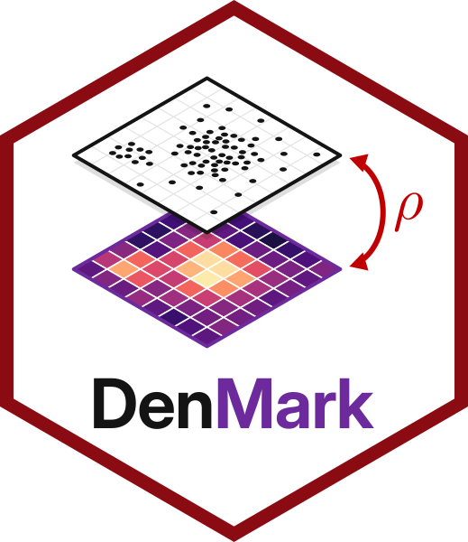
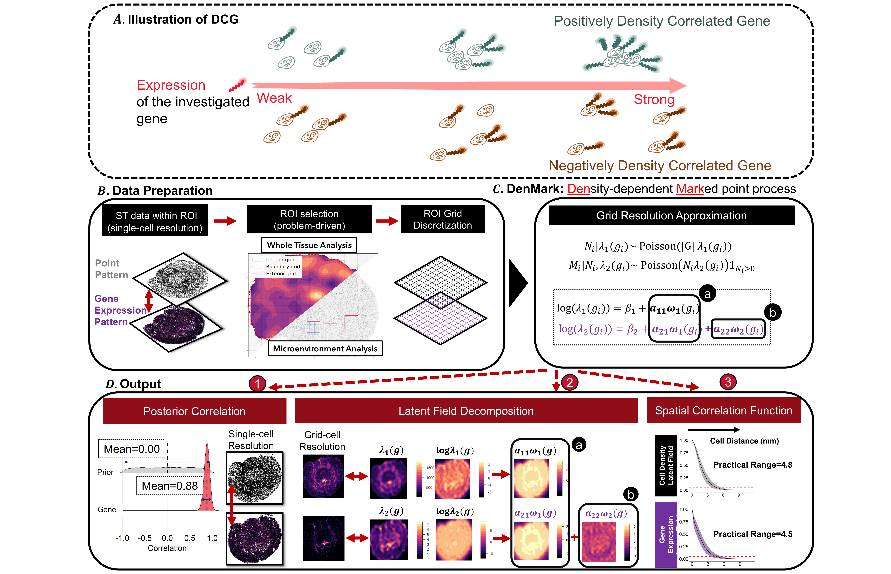

<p align="center">
  
</p>

<!-- badges: start -->
<p align="center">
  <a href="https://github.com/StaGill/DenMark/actions/workflows/R-CMD-check.yaml"></a>
  <a href="https://github.com/StaGill/DenMark/actions/workflows/python-tests.yml"></a>
  <a href="https://stagill.github.io/DenMark/"></a>
  <a href="https://stagill.r-universe.dev/DenMark"></a>
  <a href="https://github.com/StaGill/DenMark/releases"></a>
  <a href="https://github.com/StaGill/DenMark/blob/main/LICENSE"></a>
</p>
<!-- badges: end -->

**DenMark** (<ins>**Den**</ins>sity-dependent <ins>**Mark**</ins>ed point process) is a Bayesian hierarchical model for identifying density-correlated genes (DCGs) in spatial transcriptomics: genes whose expression per cell in one cell population changes between regions where that population is sparse and regions where it is crowded. DenMark aggregates the cell locations and expression of the population on a grid over the tissue, models cell counts and expression jointly as a marked log-Gaussian Cox process, and splits the spatial pattern of expression into a component shared with cell density and a gene-specific component. Each gene receives a density-expression correlation ρ with a credible interval, and a Hilbert space Gaussian process approximation keeps inference tractable on fine grids. DenMark is designed for single-cell-resolution data such as MERFISH and Xenium; the manuscript also applies it to Visium HD and to spot-level Visium, which the packages support from v1.0.0 (see below).

Mingchi Xu, Alexandra M. Schmidt\*, and Qihuang Zhang\*\
Department of Epidemiology, Biostatistics and Occupational Health, McGill University (\*corresponding authors: <alexandra.schmidt@mcgill.ca>, <qihuang.zhang@mcgill.ca>)

**Documentation:** <https://stagill.github.io/DenMark/>



By modeling where cells crowd and how strongly a gene is expressed across the tissue, DenMark enables analyses such as:

- estimating, for each gene, the correlation between local cell density and expression per cell, with a 95% credible interval;
- separating the spatial pattern of expression into a part shared with cell density and a gene-specific part;
- measuring the spatial scale of density and expression with spatial correlation functions and practical ranges;
- screening a gene panel for positively and negatively density-correlated genes.

This repository contains the reference R and Python implementations accompanying the DenMark manuscript (Xu, Schmidt and Zhang, 2026; under review at *Cell Reports Methods*).

---

## Repository layout

- `R/`, `man/`, `inst/`, `tests/testthat/`, `vignettes/`: the R package `DenMark`, at the repository root. `inst/stan/` holds the Stan models and `inst/extdata/` the toy data.
- `python/`: the Python package `denmark`, which builds the same Stan data and fits the same models through cmdstanpy.
- `CodeInPaper/`: scripts that reproduce the analyses in the manuscript, one subfolder per case study. See `CodeInPaper/README.md`.
- `data-raw/make_toy_data.R`: rebuilds the toy data.
- `Tutorial_DenMark.Rmd` / `Tutorial_DenMark.pdf`: a worked tutorial on a simulated tissue section (the simulation behind the toy data) and the Xenium breast cancer section, with a Python section. It sources the script version of the R functions (`DenMark/DenMark-functions.R`, which the packages replace; it remains in the git history) and also fits the simplified model and compares models by WAIC, which the packages no longer include. With the packages, read the PDF and run the [Get started](https://stagill.github.io/DenMark/articles/DenMark.html) vignette, which follows the same tissue-boundary workflow.
- `CITATION.cff`: citation metadata.
- `LICENSE`: MIT license.

---

## API at a glance

The steps of the STAR Methods map to the following functions. Python mirrors R function by function; a Python fit is a `DenMarkResult` whose methods take the place of the R post-processing functions.

| Manuscript step (STAR Methods) | R | Python |
|---|---|---|
| Gene filtering (Data Preprocessing): variance in the top 95%, nonzero in at least 5% of cells | `denmark_filter_genes()` | `filter_genes()` |
| Tissue domain (Data Preprocessing): alpha shape of all cells; grids outside it are excluded and grids that straddle it enter with their area inside the tissue | `denmark_alpha_shape()`, `plot_denmark_boundary()` | `alpha_shape()`, `plot_boundary()` |
| Grid-based approximation: cell count and summed expression per grid | `buildgridpp()`, `grid_pts_centroid()` | `buildgridpp()`, `grid_pts_centroid()` |
| Region of interest centered on [-L1, L1] x [-L2, L2]; HSGP basis functions and boundary factor | `denmark_prepare()`, `denmark_hsgp_indices()` | `prepare_data()`, `hsgp_indices()` |
| Density-dependent marked log-Gaussian Cox process, sampled by Hamiltonian Monte Carlo in CmdStan | `DenMark()`, `denmark_model()`, `denmark_init()` | `DenMark()`, `compile_model()`, `make_init()` |
| Posterior of ρ, the marginal standard deviations and the coregionalization matrix | `denmark_summary()`, `denmark_draws()` | `.summary()`, `.draws()`, `.rho` |
| Decomposition of expression into density-shared and gene-specific components | `denmark_fields()` | `.fields()` |
| Spatial correlation functions and practical ranges | `denmark_decay()` | `.decay()` |
| DCG calls from the 95% credible interval of ρ (Quantification and statistical analysis) | `denmark_scan()` | `scan_genes()` |

`denmark_check_hsgp()` (Python: `.check_hsgp()`) checks the number of basis functions and the boundary factor against the rule of thumb of Riutort-Mayol et al. (2023). The figures come from `plot_denmark_boundary()`, `plot_denmark_grid()`, `plot_denmark_fields()`, `plot_denmark_decay()` and `plot_denmark_scan()` in R (ggplot2), and from `plot_boundary()`, `plot_grid()`, `plot_fields()`, `plot_decay()` and `plot_scan()` in Python (matplotlib).

The revised manuscript also uses the total transcript count as the expression offset on Visium HD and Visium, and pools Visium spots into seven-spot super-grids. These arrive in the packages in v1.0.0. Version 0.9.0 uses the cell count as the offset; the total-UMI Stan model used by the revision scripts is already bundled in `inst/stan/`.

---

## Toy data

A simulated tissue section with a known answer ships with both packages for examples and tests: 7,449 cells in an irregular, lobed section inside the window [0, 6] x [0, 4], with coordinates `x`, `y`, the cell type `celltype` and counts for three genes. The 3,449 `Tumor` cells are the population analyzed; their true density-expression correlations are ρ = 0.6 (`geneA`), 0 (`geneB`) and -0.6 (`geneC`). The 4,000 `Other` cells only delineate the tissue.

`data-raw/make_toy_data.R` rebuilds it with `denmark_simulate()`, the simulation of `Tutorial_DenMark.Rmd`; the [Toy data](https://stagill.github.io/DenMark/articles/toy-data.html) article describes it.

---

## Choose your language

DenMark comes as an R package and a Python package that build the same Stan data and fit the same Stan models; the table above maps their function names. The rest of this page has one self-contained part per language, so read the one you use:

- **[DenMark in R](#use-denmark-from-r)**: installation, the toy data, a quick start and a step-by-step analysis with the R package `DenMark`.
- **[DenMark in Python](#use-denmark-from-python)**: the same with the Python package `denmark`.

The documentation site has a Get started page for each: [in R](https://stagill.github.io/DenMark/articles/DenMark.html) and [in Python](https://stagill.github.io/DenMark/articles/python.html).

---

## Use DenMark from R

### Installation

DenMark is distributed from the StaGILL R-universe (<https://stagill.r-universe.dev>), which builds it for Windows, macOS and Linux after every change, and it fits its models with Stan through [cmdstanr](https://mc-stan.org/cmdstanr/), distributed from the Stan R-universe. In R:

```r
install.packages(c("DenMark", "sf", "patchwork"),
                 repos = c("https://stagill.r-universe.dev",
                           "https://stan-dev.r-universe.dev",
                           "https://cloud.r-project.org"))
cmdstanr::install_cmdstan()
```

`install_cmdstan()` downloads and builds CmdStan once per machine and needs a C++ toolchain (Rtools on Windows, the Xcode command line tools on macOS). The sf package is needed only for the tissue boundary (`denmark_alpha_shape()`) and patchwork only to combine figure panels; DenMark installs and fits models without them.

```r
library(DenMark)
packageVersion("DenMark")
```

### Toy data

```r
library(DenMark)
toy <- denmark_toy_data()
head(toy)
table(toy$celltype)
```

### Quick start

One gene, with short chains on a coarse grid. Real analyses use finer grids (30 x 30 to 50 x 50 in the manuscript) and the default sampler settings (4 chains, 1,000 warm-up and 1,000 sampling iterations).

```r
library(DenMark)

toy <- denmark_toy_data()
tissue <- denmark_alpha_shape(toy$x, toy$y)   # tissue boundary from all cells
tumor <- subset(toy, celltype == "Tumor", select = -celltype)
fit <- DenMark(tumor, gene = "geneA", boundary = tissue, grid_size = 10, basis = 10,
               chains = 2, iter_warmup = 500, iter_sampling = 500, seed = 2024)
fit                    # rho with its 95% credible interval and sampler diagnostics
denmark_summary(fit)   # posterior summary of the key parameters; rho is Astar[2,1]
```

The tissue boundary is computed from all cells of the section, not only the Tumor cells: the region where a Tumor cell could have been observed is the whole tissue, and empty grids outside it would otherwise read as regions of low density. `DenMark()` grids the Tumor cells, drops the grids outside the tissue, builds the Stan data, compiles the model and samples. Grids that straddle the boundary enter with their area inside the tissue, through the variable-area model `DenMark-vararea.stan`; without `boundary`, the bounding box of the cells is gridded with a common grid area. The first fit compiles the Stan model; later fits reuse it.

### Step by step

With your own data, start from one row per cell of the section, with coordinates `x`, `y`, the cell type and raw counts, one column per gene. The tissue boundary uses all cells; the model uses the cells of the focal population:

```r
cells <- read.csv("cells.csv")   # columns x, y, celltype and one count column per gene
tissue <- denmark_alpha_shape(cells$x, cells$y)
focal <- subset(cells, celltype == "Tumor", select = -celltype)
genes <- denmark_filter_genes(focal[, setdiff(names(focal), c("x", "y"))])
fit <- DenMark(focal, gene = genes[1], boundary = tissue, grid_size = 30)
```

The functions behind `DenMark()` can also be run one at a time. On the toy data:

```r
library(DenMark)
toy <- denmark_toy_data()
tumor <- subset(toy, celltype == "Tumor", select = -celltype)

# Tissue boundary: alpha shape of all cells, not only the Tumor cells
tissue <- denmark_alpha_shape(toy$x, toy$y)
c(alpha = attr(tissue, "alpha"), area = as.numeric(sf::st_area(tissue)))

# Grid: cell counts Y and summed expression M per grid, with x varying fastest;
# with a boundary, each grid is interior, boundary or exterior
g <- buildgridpp(grid_size = 10, dataset = tumor, gene = "geneA", boundary = tissue)
table(g$grid$type)
plot_denmark_boundary(toy, tissue, grid = g, highlight = toy$celltype == "Tumor")
plot_denmark_grid(g)

# Stan data: the grids inside the tissue, centered on the region, with one log area each;
# HSGP basis functions and boundary factor
prep <- denmark_prepare(tumor, gene = "geneA", grid_size = 10, basis = 10, boundfactor = 1.5,
                        boundary = tissue)
str(prep$stan_data, max.level = 1)

# Fit the model
fit <- DenMark(tumor, gene = "geneA", boundary = tissue, grid_size = 10, basis = 10,
               chains = 2, iter_warmup = 500, iter_sampling = 500, seed = 2024)

# Interpret: draws of rho and of a11, a21, a22; latent fields; spatial correlation decay
draws <- denmark_draws(fit)
quantile(draws$rho, c(0.025, 0.5, 0.975))
plot_denmark_fields(fit)
denmark_decay(fit)$ranges
plot_denmark_decay(fit)
denmark_check_hsgp(fit)

# Screen genes: PCG if the 95% credible interval of rho lies above 0, NCG if below 0
scan <- denmark_scan(tumor, boundary = tissue, grid_size = 10, basis = 10,
                     chains = 2, iter_warmup = 500, iter_sampling = 500, seed = 2024)
scan[, c("gene", "rho_mean", "rho_lower", "rho_upper", "class")]
plot_denmark_scan(scan)

# Keep a fit for a later session (the CmdStan output files are temporary)
path <- file.path(tempdir(), "denmark_geneA.rds")
denmark_save(fit, path)
fit <- denmark_load(path)
```

---

## Use DenMark from Python

### Installation

```bash
pip install "denmark[boundary,plot] @ git+https://github.com/StaGill/DenMark#subdirectory=python"
python -m cmdstanpy.install_cmdstan
```

The package needs Python 3.9 or later. Both extras are optional: `boundary` adds shapely, which the tissue boundary (`alpha_shape()`) needs, and `plot` adds matplotlib for the figures. `pip install "git+https://github.com/StaGill/DenMark#subdirectory=python"` installs the package without them, and `pip install shapely` adds the boundary to an existing installation. The importable name is `denmark`:

```python
import denmark as dm
print(dm.__version__)
```

### Toy data

```python
import denmark as dm
toy = dm.datasets.load_toy()
print(toy.head())
print(toy["celltype"].value_counts())
```

### Quick start

One gene, with short chains on a coarse grid. Real analyses use finer grids (30 x 30 to 50 x 50 in the manuscript) and the default sampler settings (4 chains, 1,000 warm-up and 1,000 sampling iterations).

```python
import denmark as dm

toy = dm.datasets.load_toy()
tissue = dm.alpha_shape(toy["x"], toy["y"])   # tissue boundary from all cells
tumor = toy[toy["celltype"] == "Tumor"].drop(columns="celltype")
res = dm.DenMark(tumor, gene="geneA", boundary=tissue, grid_size=10, basis=10,
                 chains=2, iter_warmup=500, iter_sampling=500, seed=2024)
print(res)             # rho with its 95% credible interval and sampler diagnostics
print(res.summary())   # posterior summary of the key parameters; rho is Astar[2,1]
```

As in R, the tissue boundary comes from all cells of the section, and `DenMark()` grids the Tumor cells, drops the grids outside the tissue and fits the variable-area model. The first fit compiles the Stan model; later fits reuse it.

### Step by step

With your own data, start from one row per cell of the section, with coordinates `x`, `y`, the cell type and raw counts, one column per gene. The tissue boundary uses all cells; the model uses the cells of the focal population:

```python
import pandas as pd
import denmark as dm

cells = pd.read_csv("cells.csv")   # columns x, y, celltype and one count column per gene
tissue = dm.alpha_shape(cells["x"], cells["y"])
focal = cells[cells["celltype"] == "Tumor"].drop(columns="celltype")
genes = dm.filter_genes(focal.drop(columns=["x", "y"]))
res = dm.DenMark(focal, gene=genes[0], boundary=tissue, grid_size=30)
```

The functions behind `DenMark()` can also be run one at a time. On the toy data:

```python
import os
import tempfile

import denmark as dm

toy = dm.datasets.load_toy()
tumor = toy[toy["celltype"] == "Tumor"].drop(columns="celltype")

# Tissue boundary: alpha shape of all cells, not only the Tumor cells
tissue = dm.alpha_shape(toy["x"], toy["y"])
print(tissue.alpha, tissue.area)

# Grid: cell counts Y and summed expression M per grid, with x varying fastest;
# with a boundary, each grid is interior, boundary or exterior
g = dm.buildgridpp(10, tumor, gene="geneA", boundary=tissue)
fig = dm.plot_boundary(toy, tissue, grid=g, highlight=toy["celltype"] == "Tumor")
fig = dm.plot_grid(g)

# Stan data: the grids inside the tissue, centered on the region, with one log area each;
# HSGP basis functions and boundary factor
prep = dm.prepare_data(tumor, gene="geneA", grid_size=10, basis=10, boundfactor=1.5,
                       boundary=tissue)
print(sorted(prep["stan_data"]))

# Fit the model
fit = dm.DenMark(tumor, gene="geneA", boundary=tissue, grid_size=10, basis=10,
                 chains=2, iter_warmup=500, iter_sampling=500, seed=2024)

# Interpret: draws of rho and of a11, a21, a22; latent fields; spatial correlation decay
draws = fit.draws()
print(draws["rho"].quantile([0.025, 0.5, 0.975]))
fig = dm.plot_fields(fit)
print(fit.decay()["ranges"])
fig = dm.plot_decay(fit)
print(fit.check_hsgp())

# Screen genes: PCG if the 95% credible interval of rho lies above 0, NCG if below 0
scan = dm.scan_genes(tumor, boundary=tissue, grid_size=10, basis=10, chains=2,
                     iter_warmup=500, iter_sampling=500, seed=2024)
print(scan[["gene", "rho_mean", "rho_lower", "rho_upper", "class"]])
fig = dm.plot_scan(scan)

# Keep a fit for a later session (the CmdStan output files are temporary)
path = os.path.join(tempfile.gettempdir(), "denmark_geneA.pkl")
dm.save_result(fit, path)
fit = dm.load_result(path)
```

---

## Reproducing results from the manuscript

Release v1.0.0 will be the version that accompanies the manuscript. Later releases may change the results, so install that version to reproduce them once it is tagged. The scripts under [`CodeInPaper/`](https://github.com/StaGill/DenMark/tree/main/CodeInPaper) reproduce the main analyses. Each script begins with a CONFIGURE ME block that sets the data, output and repository paths, and `CodeInPaper/README.md` maps the scripts to the Results subsections and figures, with dataset access instructions and any inputs not yet in the repository:

- `Simulation/`: false and true positive rates of the DCG calls on simulated genes of known status.
- `MERFISH-MouseBrain/`: density-correlated genes of astrocytes in the Vizgen mouse brain data, section S3R1 in detail and nine sections for reproducibility.
- `Xenium-BreastCancer/`: three tumor microenvironments and whole-section fits of DCIS, invasive tumor and CD8+ T cells in a 10x Xenium breast tumor.
- `OvarianCancer-VisiumHD-Xenium5K/`: density correlations of tumor-cell programs on adjacent Visium HD and Xenium Prime 5K sections of one ovarian tumor.
- `Visium-ColorectalCancer/`: a 10x Visium CytAssist colorectal cancer section with nuclei counted from the H&E image, and Visium-like spots built from the Xenium breast section.

**Data sources:**

- Mouse brain MERFISH (Vizgen MERSCOPE): <https://console.cloud.google.com/storage/browser/public-datasets-vizgen-merfish>
- Human breast cancer (10x Xenium): <https://www.10xgenomics.com/products/xenium-in-situ/human-breast-dataset-explorer>
- Human ovarian cancer (10x Visium HD): <https://www.10xgenomics.com/datasets/visium-hd-cytassist-gene-expression-ovarian-cancer-discovery-fresh-frozen>
- Human ovarian cancer (10x Xenium Prime 5K and Xenium v1): <https://www.10xgenomics.com/datasets/xenium-comparison-fresh-frozen-human-ovarian-cancer>
- Human colorectal cancer (10x Visium CytAssist, FFPE, 11 mm capture area): <https://www.10xgenomics.com/datasets/human-colorectal-cancer-11-mm-capture-area-ffpe-2-standard>

---

## Citation

The DenMark manuscript is under review at *Cell Reports Methods*. If you use DenMark in your research, please cite the preprint (see `CITATION.cff`, which GitHub renders as a "Cite this repository" button, or run `citation("DenMark")` in R):

> Xu M, Schmidt AM, Zhang Q. DenMark: A Bayesian Hierarchical Model for Identifying Cell-Density Correlated Genes from Spatial Transcriptomics. *bioRxiv*, 2026. <https://doi.org/10.64898/2026.04.02.713482>

---

## License

MIT (see `LICENSE`).
